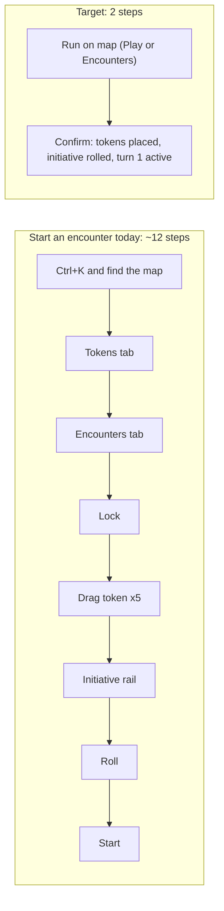
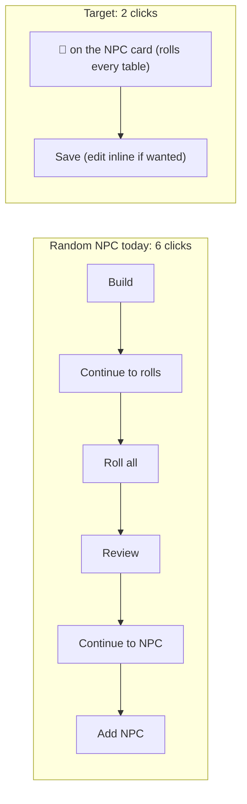

# WorldWatcher: how many clicks a DM needs, and how to cut them

**Counts traced from the client code on 2026-09-25.** Each **step** is one click, one hotkey, one drag, or one typed entry (typing plus Enter counts as one step). Each row starts from the page where the task normally happens.

**Headline:** the common session actions take about **115 steps today**. The target is **about 45**, a 61% cut. Almost all of that saving comes from five changes (see the end).

## 1. Combat (Map page)

| Task | Now | Target | How to get there |
|---|:-:|:-:|---|
| Start a prepared encounter (5 creatures) | **~12** | **2** | "Run on map": place every token, roll initiative, start. Today you drag each token one at a time |
| Start combat with tokens already on the map | 3 (2 keys) | **1** | Put "Start combat" (roll + start) on the quick bar |
| Enter the players' initiative rolls | 2 per PC | 1 per PC | Tab straight through the d20 fields |
| Next turn / previous turn | 1 / key only | 1 / 1 | Add a Previous-turn button |
| Add a condition to a token | 3–4 | **2** | Right-click the token to get a condition chip row, then tick |
| Damage one token | 3 | **2** | Select the token and type `-7⏎`; a number opens the damage box |
| Fireball on 4 goblins (2 save for half) | **~10** | **3** | Drag the AoE, click "Apply to 4 inside", then type `8d6⏎`; saves and halving happen automatically |
| Place an AoE template | 3 (+2 colour) | **2** | A hotkey per shape, then drag with a feet readout and grid snap |
| Move or resize a placed AoE | impossible (erase and redraw, 3) | 1 | Make shapes selectable and draggable |
| Add a creature mid-combat | 4 | **2** | Ctrl+K and type the creature, then Enter drops it at the view centre |
| Change one combatant's initiative | 4 | 2 | Click the number and type |
| Open a creature's stat block | 1 | 1 ✓ | Double-clicking a token already does this |
| Roll 8d6 | **9** | **2** | A notation box: D, then `8d6⏎` |
| Reveal a fog area | 4 | 2 | Keep the brush armed after the popover closes |



## 2. Random generators (Play > Items > Random Tables)

| Task | Now | Target | How to get there |
|---|:-:|:-:|---|
| Random NPC | **6** | **2** | Card dice, then Save. The wizard is Build → Continue → Roll all → Review → Continue → Add, and it should collapse to a one-screen preview with the tables pre-picked |
| Manual NPC | 5 | 2 | Ctrl+K "New NPC" should open the dialog; today it only opens the folder. Then type the name⏎ |
| Random place / settlement | 5 | **2** | The same collapse as the NPC wizard |
| Random tavern | ~6 (manual) | **2** | A "Tavern" preset in the place builder |
| Random shop and inventory | **doesn't exist** | **2** | New shop builder: shop type plus stock drawn from the magic-item compendium by rarity, stored as FK references rather than copied text |
| Random encounter | 5 | **2** | Roll, then Save |
| …and then run it | +~12 | **1** | "Run on map" from the Encounters tab (as in section 1) |
| Random scenario / plot hook | 3, then retype into a quest (~8) | **2** | Hook builder (premise + twist + climax), then "Save as quest" |
| Roll any table | 1 | 1 ✓ | The row's dice icon already does this |
| Pin a table | 2 | 1 | Put a pin icon on the browse row |



## 3. Running the session (Play page)

| Task | Now | Target | How to get there |
|---|:-:|:-:|---|
| Home to a running Play page | 3 (1 via Resume) | **1** | A "Run" button on every campaign card |
| Look up a creature | 5 from default tabs | **2** | Ctrl+K entity search, then the result opens a popup |
| Read a spell or item's full text | +1 and you leave Play (160-character preview) | 1 | Show the full text inline |
| Look up a condition (Prone, Grappled…) | **impossible** | 1 | Condition entities that can be @-mentioned and hovered |
| Information popup on an @mention | click, 250 ms wait, takes over a pane | **0** | A hover card; click only to pin it |
| Get a chat pane in the default layout | 2–3 (switch + start thread) | **0** | Include chat in the default layout and create the thread automatically |
| Send a chat message | 3 | 2 | Autofocus the composer |
| Roll anything but a d20 | **impossible** | 1 | `/r 2d6+3` in chat, logged to the thread |
| Quick session note | 3 | **1** | A hotkey (e.g. `Ctrl+.`) that appends to the session note |
| Open the map / an NPC from Play | 2 / 5 | 1 / 2 | A map pane kind; the palette jumps to the entity, not its folder |
| Advance time, weather, recap, timers | don't exist | 1 each | Session-bar widgets (a later phase) |

## 4. Prep

| Task | Now | Target | How to get there |
|---|:-:|:-:|---|
| New quest / faction | 5 | 2 | The palette's "New…" should open the dialog (today `?new=1` is ignored on Notes and World Manager) |
| New article | 4 | 3 | Remember the last template |
| New note | 2 | 2 ✓ | |

## 5. Bugs that add clicks (fix these first, they're cheap)

| Bug | Effect |
|---|---|
| Clicking a campaign never makes it the active campaign | Play, the Run menu and the palette stay disabled until a campaign URL is visited |
| The command palette has no arrow-key or Enter selection | Every palette use needs a mouse click |
| The palette labels Play as "Coming soon" | DMs don't find it |
| Alt+Shift+I during combat re-rolls everyone | The round and turn are lost, with no confirmation |
| Reset layout / Clear window have no confirmation | Every pin is wiped |
| J/K steps through tokens in placement order, not initiative order | Keyboard targeting is useless |
| Move Up/Down, Quick Add, Player View are unwired | They are in the shortcut settings and on the toolbar defaults, but do nothing |

## 6. The five changes that matter most

```
 Steps saved per session (estimate, a typical 3-fight session)
 1 Run-on-map (one-click encounter start)   ████████████████████  ~30
 2 AoE "apply to tokens inside" + auto saves ███████████████       ~21
 3 Dice notation (panel + /r in chat)        ██████████            ~14
 4 Generators collapse to Roll -> Save       ████████              ~12
 5 Hover info cards + Ctrl+K entity search   ███████               ~10
```

1. **Run on map.** One button places the roster, rolls initiative and starts turn 1.
2. **Make AoE shapes targeting tools.** Select the tokens inside, apply damage once, and roll saves with halving.
3. **Dice notation everywhere.** `8d6` in the dice panel and `/r` in chat, and a roll result can feed straight into damage.
4. **Two-click generators.** Roll → Save for NPC, place, encounter and a new shop builder, and "Save as quest" for hooks.
5. **Zero-click information.** Hover cards on mentions and conditions, and a Ctrl+K search that covers the compendium.
